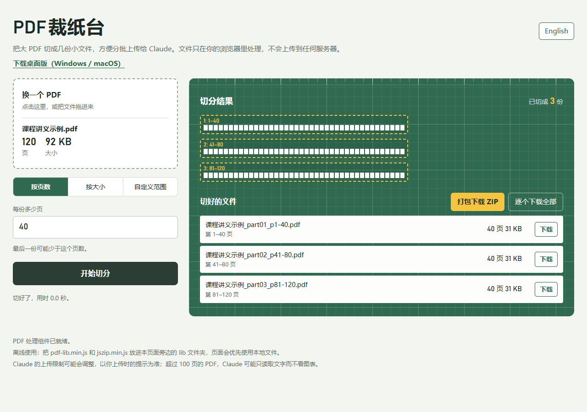

# PDF 裁纸台 · PDF Splitter

**简体中文** | [English](README.en.md)

轻量、免费开源的 **PDF 拆分工具**。按页数、文件大小或自定义页码范围切分 PDF，文件在本地处理，无需注册，也不会上传到服务器。

A lightweight, privacy-friendly PDF splitter for the browser, Windows and macOS. Split by page count, file size or custom page ranges — your PDF stays on your device.

**[在线体验](https://www.loners.site/PDF-Cutter/) · [下载桌面版](https://github.com/MongxinChan/PDF-Cutter/releases/latest) · [反馈问题](https://github.com/MongxinChan/PDF-Cutter/issues)**

[](https://github.com/MongxinChan/PDF-Cutter/releases/latest)
[](LICENSE)

- **本地处理**：PDF 文件不会上传，桌面版内置组件，可离线使用。
- **三种拆分方式**：按页数、按大小、自定义范围；大小和页数限制可同时设置。
- **批量导出**：单份下载、逐个保存全部，或打包为 ZIP。
- **轻量桌面版**：v1.0.1 Windows 安装包约 **1.31 MiB**，免安装版约 **3.32 MiB**。
- **跨平台**：可直接在浏览器使用，也提供 Windows 和 macOS 桌面版。

> Windows 桌面版需要 WebView2。上述体积不包含完整运行时；安装版会在缺少运行时时联网安装，免安装版需要系统已安装 WebView2。

## 看看实际效果



*实际界面截图，使用生成的示例讲义演示：120 页 → 3 份，每份 40 页。*

## 适合哪些场景？

- **整理教材和课程讲义**：按章节提取页码范围，或每隔固定页数拆成一份。
- **分批上传给 AI 工具**：根据 Claude 等工具的文件大小和页数要求拆分文档。
- **分享大型 PDF 或扫描件**：按目标大小分成小文件，再批量保存或打包发送。

| 拆分方式 | 例子 |
| --- | --- |
| 按页数 | 120 页讲义，每 40 页一份，得到 3 个 PDF |
| 按大小 | 每份不超过 10 MB，并同时限制每份最多 50 页 |
| 自定义范围 | 输入 `1-20, 35-60, 80-`，分别提取对应页码范围 |

按大小拆分会根据实际输出文件试切；如果单页本身已经超过上限，会保留该页并显示提示。

## 三步上手

1. 打开 **[在线版](https://www.loners.site/PDF-Cutter/)** 或桌面 App，拖入一个 PDF，也可以点击选择文件。
2. 选择拆分方式并填写参数，查看页码范围预览。
3. 点击“开始切分”，完成后下载单份文件，或点击“打包下载 ZIP”。

桌面版会将文件保存到 **下载 / PDF裁纸台**，遇到同名文件自动加编号，不覆盖已有文件；批量导出结束后打开一次文件夹。网页版的保存位置由浏览器管理。

## 下载桌面版

前往 **[最新版本 Releases](https://github.com/MongxinChan/PDF-Cutter/releases/latest)**，根据系统选择：

| 系统 | 下载文件 |
| --- | --- |
| Windows x64，安装版 | `pdf-cutter-版本号-windows-setup.exe` |
| Windows x64，免安装版 | `pdf-cutter-版本号-windows-portable.exe` |
| macOS，Apple 芯片（M1 及以后） | `pdf-cutter-版本号-mac-arm64.dmg` |
| macOS，Intel 芯片 | `pdf-cutter-版本号-mac-x64.dmg` |

桌面版使用 **Tauri 2 + 系统 WebView**。相比 v1.0.0 的 Electron 版，Windows 安装包从约 **106.29 MiB** 降到 v1.0.1 的约 **1.31 MiB**。这是应用分发包体积的比较，不包含 WebView2 运行时占用，也不代表处理 PDF 时的内存用量。

首次启动可能出现未签名应用提示，处理方式见下方常见问题。

## 常见问题

<details>
<summary>文件会上传吗？没有网络能用吗？</summary>

PDF 的读取、切分和 ZIP 打包均在本地完成，不会上传文档。

在线版首次打开需要加载网页及组件。桌面版内置全部处理组件，安装和运行时准备就绪后，可离线处理文件。也可以按[开发文档](docs/DEVELOPMENT.md)组装离线网页。

</details>

<details>
<summary>这是 PDF 压缩工具吗？</summary>

它用于拆分、提取 PDF 页面，不提供图片降质压缩或页边裁剪。如果单页已经超过设定大小，拆分无法让这一页满足限制，工具会给出提示。

</details>

<details>
<summary>Claude 的上传限制是多少？</summary>

界面提供 30 MB、100 页的快捷预设，两个参数均可调整。平台限制可能随产品、账户和时间变化，请以实际上传时的提示为准。

</details>

<details>
<summary>第一次打开桌面版被系统拦截怎么办？</summary>

应用目前没有购买苹果和微软的开发者签名证书。确认文件来自本仓库的 [Releases](https://github.com/MongxinChan/PDF-Cutter/releases/latest) 后：

- **Windows** 提示“Windows 已保护你的电脑”：点击“更多信息”，再点击“仍要运行”。
- **macOS** 提示无法验证开发者：先关闭提示，再到“系统设置 → 隐私与安全性”中找到该 App，点击“仍要打开”；较旧系统也可在“应用程序”里右键 App，选择“打开”。
- **macOS** 提示“已损坏，无法打开”：把 App 放入“应用程序”文件夹，确认下载来源后，在终端执行：

```bash
xattr -cr "/Applications/PDF 裁纸台.app"
```

</details>

## 本地开发

建议使用 Node.js 24 LTS、Rust stable，并按系统安装 [Tauri 构建依赖](https://v2.tauri.app/start/prerequisites/)。

```bash
npm ci          # 安装依赖并准备离线 PDF / ZIP 组件
npm start       # 启动桌面开发版
npm run dist    # 构建当前系统的安装包，输出到 dist/
```

完整的平台依赖、离线网页组装、测试命令和项目结构见 **[开发与构建文档](docs/DEVELOPMENT.md)**。

## 反馈与贡献

欢迎通过 [Issues](https://github.com/MongxinChan/PDF-Cutter/issues) 反馈问题或提出建议，也欢迎提交 Pull Request。反馈时请说明系统、应用版本、复现步骤及报错信息；示例 PDF 请使用不含个人或敏感信息的文件。

如果这个工具帮你解决了问题，欢迎点一个 Star，或把在线体验链接分享给需要拆分 PDF 的人。

## 许可

[MIT License](LICENSE)
